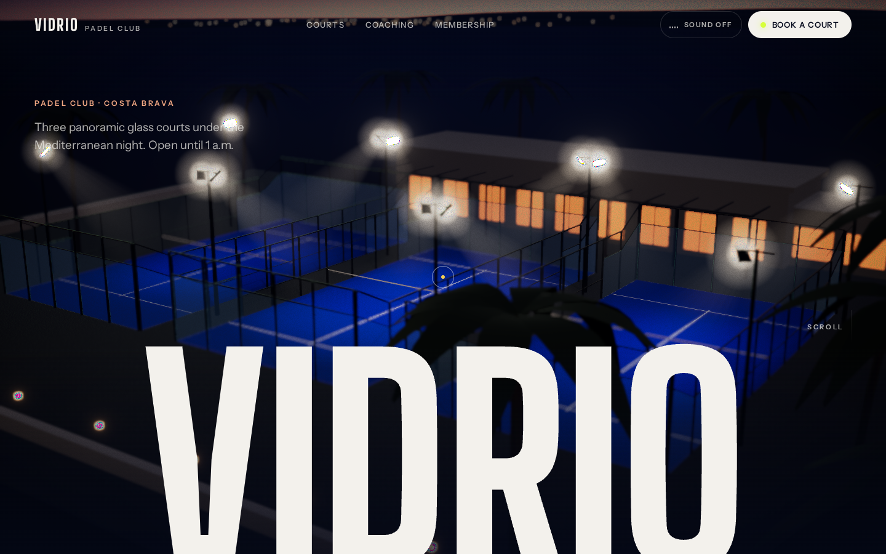

# Vidrio Padel Club: 3D scroll demo by Rooster Media

A flagship portfolio piece: a fictional Mediterranean padel club told as a
cinematic 3D scroll story. Built with Vite, React, React Three Fiber, drei,
@react-three/postprocessing, GSAP ScrollTrigger and Lenis.



---

## 1. Run it on your computer (first time)

1. **Install Node.js**: download the **LTS** version from <https://nodejs.org>
   and run the installer (keep the default options).
2. **Open a terminal** in this folder
   (macOS: Terminal app; Windows: right-click the folder → "Open in Terminal").
3. Install the project's libraries (only needed once):
   ```bash
   npm install
   ```
4. Start the development server:
   ```bash
   npm run dev
   ```
5. Open the link it prints (usually <http://localhost:5173>) in Chrome, Safari or Firefox.
   To test on your phone, open the **Network** link it prints while your phone
   is on the same Wi-Fi.

To make the final website files: `npm run build`. The finished site is in `dist/`.
Drag that folder onto <https://app.netlify.com/drop> (free) to get a live link.

### Handy URL switches (for testing)
| Add to the URL | What it does |
| --- | --- |
| `?s=2.5` | Jump to a point in the story (0 = top, 6 = end; 2.5 = glass impact) |
| `?quality=high` / `medium` / `low` | Force a quality tier |
| `?quality=none` | Preview the no-WebGL fallback (still image) |

---

## 2. How the site is built (plain language)

| File | What it is |
| --- | --- |
| `src/lib/story.js` | The six scroll chapters and how long each lasts |
| `src/three/layout.js` | Every real-world measurement: courts, light positions |
| `src/three/Court.jsx` | The courts: turf, lines, net, glass, mesh, steel posts |
| `src/three/cameraPath.js` | The camera route through the whole story (edit to reframe shots) |
| `src/three/rally.js` | The rally choreography and slow-motion timing |
| `src/three/Player.jsx` / `Racket.jsx` | The players and the padel racket, built in code |
| `src/three/Effects.jsx` | Bloom, depth of field, grain, vignette, ACES tone mapping |
| `src/lib/sound.js` | Sound effects (synthesised live, off by default) |
| `src/lib/quality.js` | Detects device power and picks a quality tier |
| `src/ui/*` | Page text, nav, loader, scoreboard, booking drawer, cursor |

**Court accuracy:** 20 × 10 m playing area; service lines 6.95 m from the net,
centre service line extending 20 cm past them; net 0.88 m at the centre and 0.92 m at the posts;
3 m back glass + 1 m mesh; side glass stepping 3 m → 2 m over the first 2 m,
2 m glass for the next 2 m, then black mesh. Three courts side by side.

**Baked lighting:** the pools of light under the floodlights are calculated once
when the page loads and painted into a texture (`groundLightMap` in
`src/three/textures.js`). That looks like dozens of lights but costs nothing
per frame.

---

## 3. Adding the real assets, step by step

The site already looks complete without any of these. Each one is optional
and drops in without code changes.

### a) HDRI (already done ✅)
`public/hdri/moonless_golf_512.hdr` is **Moonless Golf** from Poly Haven (CC0,
free for commercial use), resized for speed. To try another one:
1. Go to <https://polyhaven.com/hdris>, filter by *Night* or *Sunset*.
2. Download the **1K HDR** version.
3. Put it in `public/hdri/` and change the file name in `src/three/Lighting.jsx`
   (`files="/hdri/…"`).

### b) Animated player from Mixamo
1. Create a free Adobe account and log in at <https://www.mixamo.com>.
2. **Characters** tab → pick an athletic character (e.g. *Remy* or *Kaya*).
3. **Animations** tab → search **"tennis forehand"** (any forehand swing works).
   Untick *In Place* if offered. Set **Overdrive 0**.
4. Click **Download**: Format **FBX Binary (.fbx)**, Skin **With Skin**, 30 fps.
5. Convert FBX → GLB with **Blender** (free, <https://www.blender.org>):
   *File → Import → FBX*, then *File → Export → glTF 2.0*, Format **glTF Binary (.glb)**,
   tick *Animation*. Save it in this project folder as `player-raw.glb`.
6. Compress it (Draco + WebP textures, often 80–90% smaller):
   ```bash
   npm run optimize:player
   ```
   This writes `public/models/player.glb`. Reload the site: the mannequins are
   replaced by your character automatically, holding the code-built racket.
7. If the racket meets the ball slightly early or late, adjust
   `CONTACT_FRACTION` in `src/three/Players.jsx` (0–1 through the clip).

### c) Padel racket
Already built in code to real specs (45.5 × 26 cm, 38 mm, drilled face, open
throat). No download needed. If you'd rather use a Sketchfab model, download
its **glTF** version (check the licence allows commercial use) and compress it
with the same `gltf-transform` command.

### d) Sound effects
Sound is **off by default**, with the toggle in the nav, and every sound is
synthesised in the browser. To use recordings instead, put MP3s in
`public/audio/` with exactly these names (any you skip stay synthesised):

| File | What to search for (freesound.org / pixabay.com/sound-effects) |
| --- | --- |
| `hit.mp3` | "padel hit" or "paddle ball hit" |
| `bounce.mp3` | "tennis ball bounce" |
| `glass.mp3` | "ball hit glass" or "glass thud" |
| `ambience.mp3` | "summer night crickets crowd" (loops) |
| `applause.mp3` | "small crowd applause" |

Check each sound's licence (CC0 is simplest).

---

## 4. Performance

- The page shell is ~130 KB gzipped; the 3D engine (~325 KB gzipped) streams in behind the loader.
- Quality tiers: **high** (desktop: 4× MSAA, depth of field, 2K shadows),
  **medium** (phones: lower resolution, no DOF), **low** (old devices: no shadows,
  fewer players). A live frame-rate watchdog steps down a tier if the device
  can't hold ~45 fps.
- Measured per frame (medium tier, 390 × 844): ~45 draw calls / 21–35k triangles
  for most of the story, peaking at ~140 calls / 70k triangles during the rally.
- No WebGL → a still poster frame; `prefers-reduced-motion` → no smooth-scroll
  inertia, no orbit, no camera shake, fades instead of motion.
